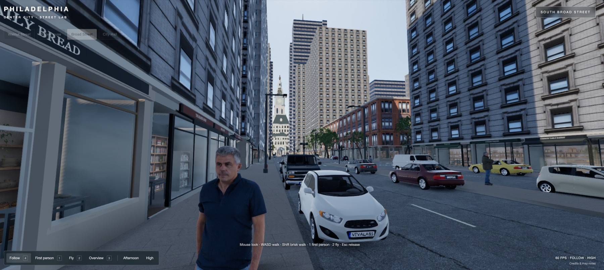
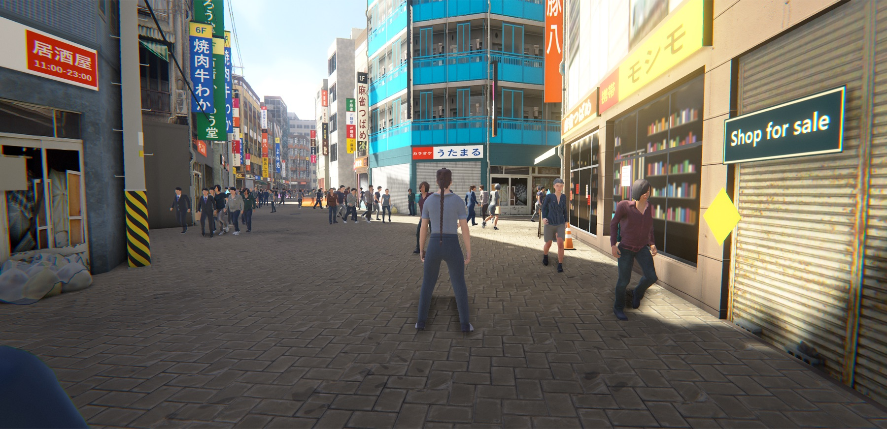
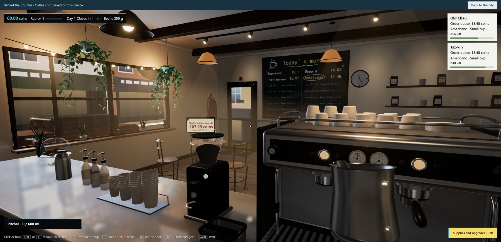
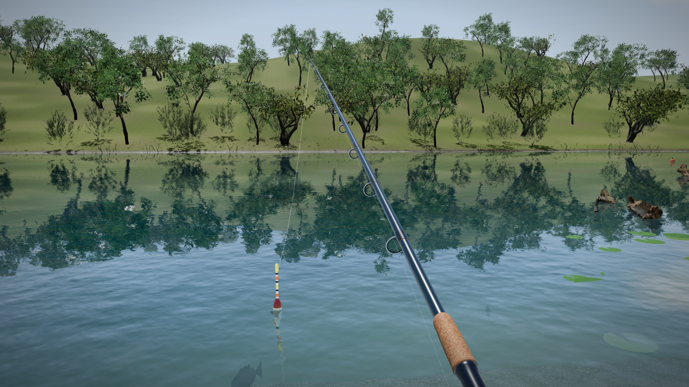

# EarthOnline

> **Live Your Second Life**

EarthOnline is an open-source, browser-based parallel Earth where players explore real cities, build relationships, participate in a shared economy, and create a second life together.

**Play:** [www.earth.online](http://www.earth.online/)  
**Community:** [Discord](https://discord.gg/yJv4cpXwT)

> EarthOnline is in active development. Available locations and features vary in completeness.



## Features

### Real Society

Join a persistent multiplayer world with players from around the globe.

EarthOnline is building a shared society with economic activities, player trading, property, businesses, elections, and policy management. Real-time multiplayer presence is available; the economy continues to expand, while elections and governance are in development.

### Simulated Characters

The long-term goal here is to simulate a world-scale population of NPCs.

Build relationships with persistent characters and unlock new interactions as those relationships develop. Player-created NPCs and deeper NPC behavior, memory, and economic participation are in development.

### Real-World Maps

Explore a growing 3D reconstruction of the real Earth.

EarthOnline aims to reproduce real streets, buildings, and places at 1:1 scale. Selected areas in Hong Kong, Tokyo, Philadelphia, Montréal, Melbourne, and Helsinki are currently available, with coverage and detail continuously improving.



### Many Ways to Live

Walk, drive, buy property, own vehicles, operate shops, and build a business empire.

Activities currently include fishing, cooking, coffee making, ramen, ice cream, tailoring, painting, car washing, interior design, photography, and local challenges. New activities will be added and connected to the wider economy.

| Run a coffee shop | Go fishing |
| --- | --- |
|  |  |

### Open-Source Worldbuilding

EarthOnline’s main project is open source.

An official EarthOnline skill is in development so humans and coding agents can contribute:

- New gameplay and simulations
- Map expansions and landmarks
- NPC behaviors and interactions
- Vehicles, buildings, and interiors
- Performance, accessibility, and tooling improvements

Contributions are reviewed before official integration. If EarthOnline becomes commercially profitable, outstanding contributors may be evaluated for incentives under a future contributor program.

### Continuous Evolution

Every system is still evolving toward one goal: a parallel world that is both fun to inhabit and convincing enough to feel alive.

## Development Status

| Area                                   | Status                  |
| -------------------------------------- | ----------------------- |
| Browser-based 3D exploration           | Available               |
| Walking, driving, and life activities  | Available               |
| Selected real-world districts          | Available and expanding |
| Real-time multiplayer presence         | Available and evolving  |
| Economy, trading, and businesses       | In active development   |
| Persistent and player-created NPCs     | In development          |
| Elections and policy management        | In development          |
| Official contributor skill             | In development          |
| Global 1:1 map and 8.3B NPC population | Long-term goal          |

## Local Development

Requirements:

- Node.js 22.18 or newer
- npm
- A browser with WebGL 2 support

```bash
git clone https://github.com/ahumbledev/EarthOnline.git
cd EarthOnline
npm ci
npm run dev
```

Start the multiplayer service separately:

```bash
npm run server
```

Test and build:

```bash
npm test
npm run build
npm run preview
```

## Contributing

EarthOnline is designed to be friendly to both developers and coding agents. It provides modular TypeScript code, machine-readable content, deterministic simulations, replay tools, validation scripts, and automated tests.

A contribution should:

1. Have a clear and limited scope.
2. Include tests or reproducible verification.
3. Document new formats, controls, or dependencies.
4. Preserve asset licenses and attribution.
5. Pass `npm test` and `npm run build`.

See [`tooling/README.md`](tooling/README.md) for contribution tools.

## License and Attribution

Project-owned code is licensed under the [MIT License](LICENSE).

Maps and external assets may use separate licenses. See:

- [Map sources](MAP-SOURCES.md)
- [Material sources](MATERIAL-SOURCES.md)
- [Character sources](public/characters/SOURCES.md)
- [Vehicle notices](public/vehicles/NOTICE.md)
- [Furniture sources](public/room/SOURCES.md)

## Links

- [Play EarthOnline](http://www.earth.online/)
- [GitHub](https://github.com/ahumbledev/EarthOnline)
- [Discord](https://discord.gg/yJv4cpXwT)
